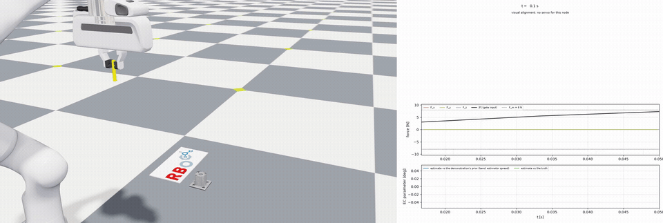
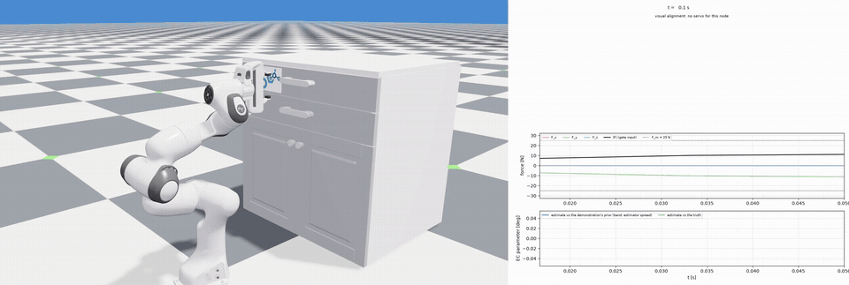

# From a Single Demonstration to a General Policy for Contact-Rich Manipulation

Xing Li and Oliver Brock

*The International Journal of Robotics Research, 2026*

[](https://lfdec.github.io/) [](https://arxiv.org/abs/2605.17601) [](https://lfdec.github.io/#tasks)

This repository implements LfDEC, a framework for learning manipulation behaviors
from a single demonstration based on environmental constraints (ECs).
Environmental constraints capture the general task structure, while hard-to-model,
instance-specific details are resolved by compliant interaction at runtime.
We believe this principle is key to achieving general manipulation behaviors.

The original implementation used Ubuntu 20.04 and ROS 1, with a Panda robot,
a wrist-mounted camera, a force-torque sensor, and custom-designed 3D-printed mounts.
This setup made the framework difficult to reproduce and adopt in other projects.
Therefore, we reimplemented the system in Isaac Lab / Newton so users can run an
example with a single command and see how EC primitives work in simulation.
The method itself is simple, and we believe that understanding the full pipeline
makes it straightforward to implement in new projects.

| Factory peg insertion | Drawer opening |
| :---: | :---: |
| [](assets/examples/factory_peg_insert.mp4) | [](assets/examples/drawer_opening.mp4) |

Click a preview to open the full video.

## Setup

Use Linux, Python 3.12 and an NVIDIA GPU (see [CPU execution](#cpu-execution) below).
Install [uv](https://docs.astral.sh/uv/getting-started/installation/)
and `ffmpeg` (`sudo apt install ffmpeg` on Ubuntu).

```bash
git clone --recursive https://github.com/tu-rbo/LfDEC.git
cd LfDEC
uv sync
```

## Examples

Run an example in Isaac Lab / Newton. The manipulation process is recorded in a video
saved under `outputs/`.

```bash
uv run python scripts/run_ec_task.py --example block_grasp_lift
uv run python scripts/run_ec_task.py --example drawer_grasp_pull
uv run python scripts/run_ec_task.py --example door_grasp_open
uv run python scripts/run_ec_task.py --example peg_insert
uv run python scripts/run_ec_task.py --example factory_peg_insert
uv run python scripts/run_ec_task.py --example nut_turn
```

Add `--show` to watch the simulation and manipulation GUI:

```bash
uv run python scripts/run_ec_task.py --example drawer_grasp_pull --show
```

## CPU execution

If you do not have a GPU, you can run the drawer example on CPU.
The complete drawer sequence is tested with CUDA hidden:

```bash
CUDA_VISIBLE_DEVICES='' uv run python scripts/run_ec_task.py \
  --task-file tasks/drawer_grasp_pull.yaml --viz none --no-monitor --no-markers \
  physics=newton_mjwarp env.sim.device=cpu
```

## License

This project uses the [MIT License](LICENSE). The two UWLab-derived files retain their
[BSD-3-Clause license](LICENSES/BSD-3-Clause-UWLab.txt).
Third-party dependencies and assets retain their own licenses.

## Citation

```bibtex
@article{li2026lfdec,
  title   = {From a Single Demonstration to a General Policy for Contact-Rich Manipulation},
  author  = {Li, Xing and Brock, Oliver},
  journal = {The International Journal of Robotics Research},
  year    = {2026}
}
```
